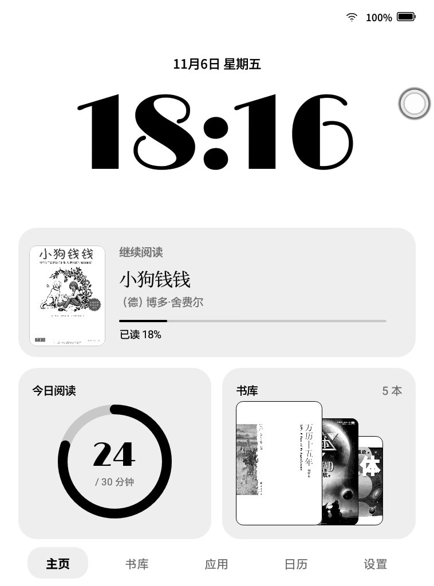
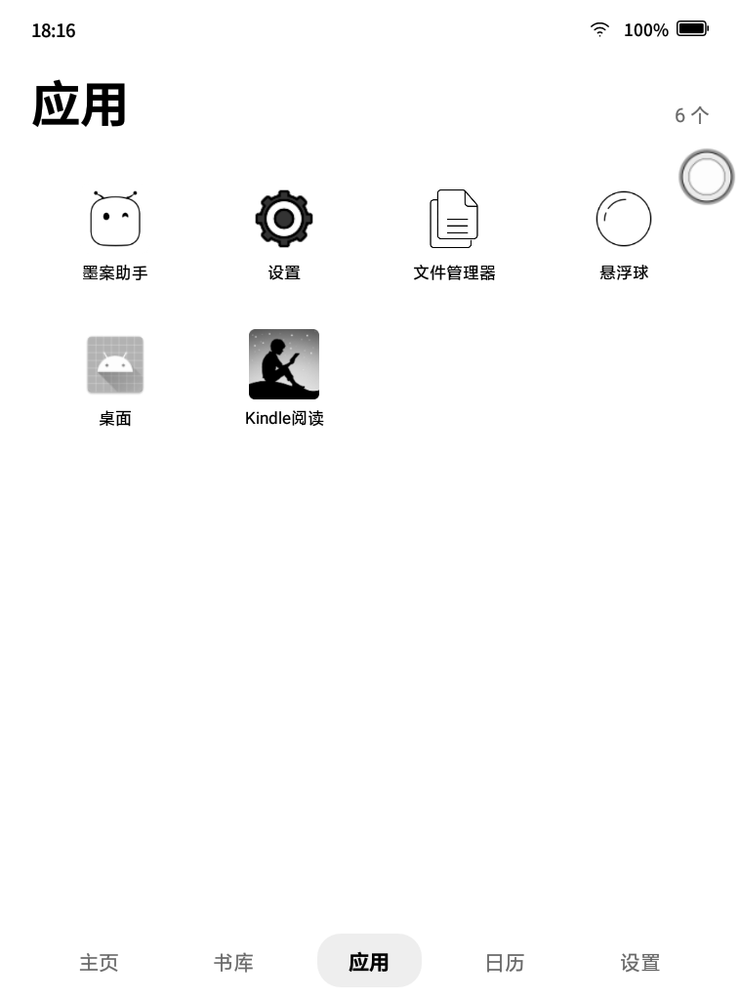
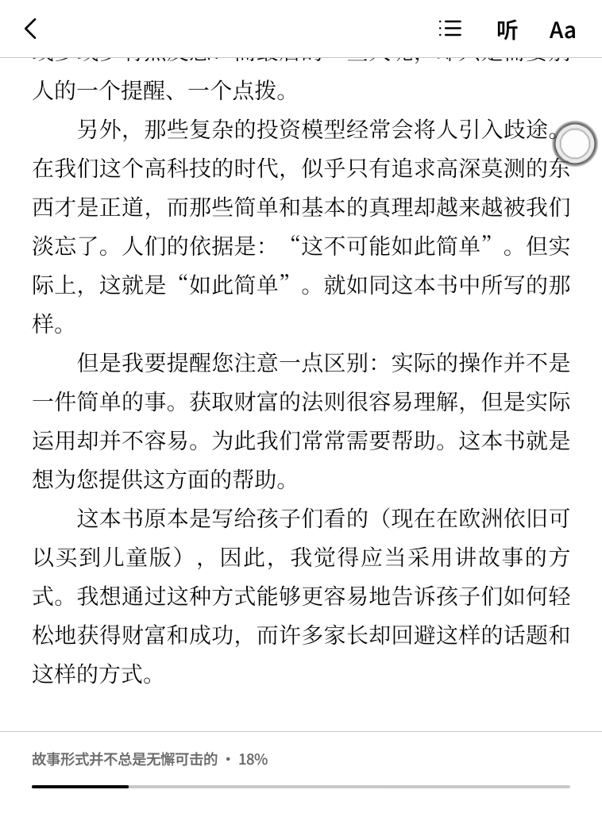
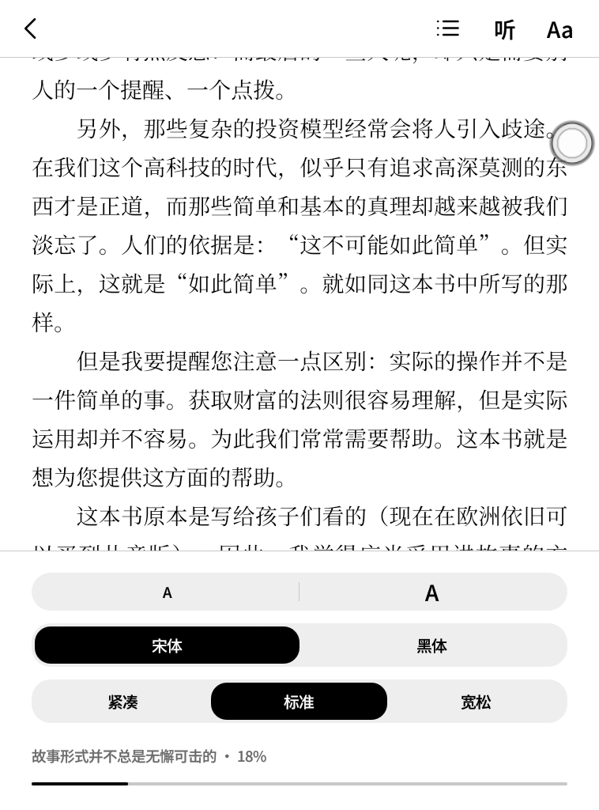
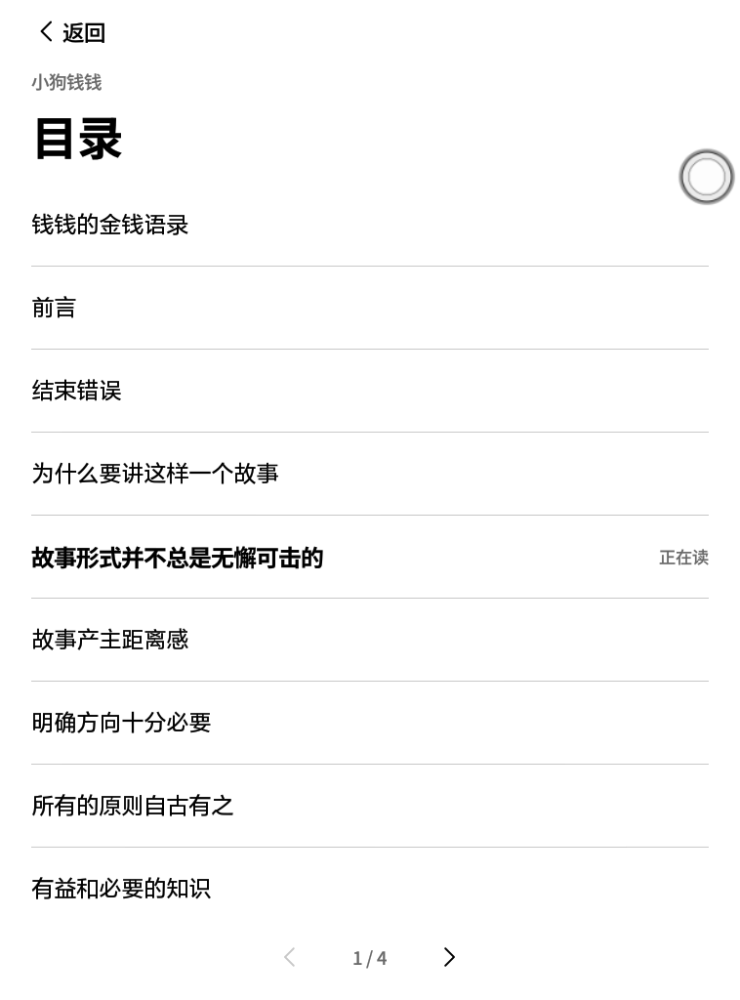

# 墨页 ink.home

给墨水屏阅读器写的桌面和阅读器。一个 Android 应用，接管主屏幕，把书库、阅读、听书和应用入口放进同一套界面。

它运行在一台 Android 8.1 的墨水屏阅读器上（型号 EPD106A，Allwinner B300，758×1024，212 dpi，约 917 MB 内存）。不用 Gradle，不用第三方库，全部 Java 代码约 3500 行。

> 这是个人项目，与设备厂商没有关系。

<table>
  <tr>
    <td width="33%"></td>
    <td width="33%"></td>
    <td width="33%"></td>
  </tr>
  <tr>
    <td align="center">主页</td>
    <td align="center">书库</td>
    <td align="center">应用</td>
  </tr>
  <tr>
    <td></td>
    <td></td>
    <td></td>
  </tr>
  <tr>
    <td align="center">阅读页和菜单</td>
    <td align="center">字体设置</td>
    <td align="center">目录</td>
  </tr>
</table>

截图是真机界面，来自作者自用的版本，有两处和这份代码不同：

- 底栏多一个「日历」，它打开的是一个没有开源的私人应用，这里的底栏是四项：主页、书库、应用、设置。
- 右上方的圆球是系统自带的悬浮球，不属于墨页。

## 功能

- 接管主屏幕：按 Home 回到墨页，也可以当普通应用打开。
- 自动导入：扫描存储根目录下的 `books`、`documents`、`download`、`kindle`，不用手动添加。
- 格式：EPUB、MOBI（含 `.prc`、`.azw`，仅 PalmDOC 或未压缩且无 DRM）、TXT、PDF。
- 阅读：翻页、目录、字号、宋体和黑体、三档行距，自动记住位置。
- 书架：同一本书有多个格式时只显示一本。
- 每日阅读：统计当天阅读分钟数，目标 30 分钟。
- 听书：调用 OpenAI 兼容的语音接口朗读当前的书，屏幕关闭后继续。

PDF 按页渲染成图片，所以没有目录、听书和字体设置。

## 设计

墨水屏不是一块慢一点的液晶屏。它只有 16 级灰，刷新慢，还会留残影。这些限制决定了下面的取舍。

**没有动画。** 所有窗口动画都关掉，界面只在两个静止状态之间切换。翻页、换屏、开合面板都是一次性完成的。

**翻页，不滚动。** 书库、应用、目录都分页：书库每页 3×2 本，应用每页 4×5 个。滚动在墨水屏上会一路留下残影，翻页只刷新一次。

**只用灰度和字重表达层级。** 全部颜色只有五个（`Ui.java`）：黑、白、两种灰、一种浅灰底。当前位置靠加粗和浅灰圆角底块表示，不靠颜色。

**字体是主要的视觉元素。** 大钟用 Limelight 这种高反差的展示字体，是主页的视觉中心。界面文字用思源黑体的 Medium 和 Bold，书名和正文用思源宋体。装进真实的字重，而不是让系统假加粗。

**一整套系统，而不是一个页面。** 主页由三张圆角卡片组成，每张都能点：

| 卡片 | 内容 | 点击 |
|---|---|---|
| 继续阅读 | 封面、书名、作者、进度 | 回到读到的地方 |
| 今日阅读 | 圆环和当天分钟数 | 只显示 |
| 书库 | 三本书叠放的封面和总数 | 进入书库 |

书库和应用页共用一个标题样式：大标题在左，数量在右。底栏四个词在所有主屏上位置不变。

**封面专门为这块屏处理。** 彩色封面直接缩放后在墨水屏上会发糊。`Cover.java` 先转灰度，把对比度提高 12%，再用 Floyd–Steinberg 误差扩散抖动到屏幕的 16 级灰。没有封面的书生成一张素色封面，用宋体排上书名和作者。

**阅读时界面退场。** 正文页只留页脚的章节和进度。点屏幕中间才出现菜单，再点一下就收起，这次点击不会同时翻页。

## 逻辑

```
src/ink/home/
  MainActivity    主页、书库、应用三屏和底栏，整屏重建
  ReaderActivity  阅读页：分页、菜单、目录、字体、听书面板
  VoiceActivity   语音接口设置
  Library         扫描、识别、去重、进度和阅读时长
  Book            一本书的记录
  Content         各格式共用的章节接口
  Epub Mobi Txt   三种可重排格式的解析
  Cover           封面合成、抖动、生成
  Ui              颜色、字体、控件和手势
  Speech          调用语音接口，把 HTML 切成可朗读的句段
  Narrator        朗读用的前台服务
```

**界面。** 不用 XML 布局，视图全部在代码里构建。`show()` 切换屏幕，`render()` 重建整屏。墨水屏本来就是整屏刷新，这样状态最简单，也不用维护局部更新。

**扫描书库。** `Library.scan()` 在后台线程按目录递归（最多 6 层），用文件名加大小跳过重复文件。已知路径直接用缓存，只有新文件才解析元数据和封面。写回之前会重新读取已保存的记录，这样扫描期间读到的新进度不会被覆盖。

**书架去重。** `Library.shelf()` 用书名和作者判断是否为同一本书的不同版本，优先显示正在读的版本。PDF 例外：PDF 不能调字号，所以只要有其他格式，就用其他格式替换它。

**分页。** 可重排格式把章节放进 WebView，用 CSS 多栏布局：栏宽等于屏宽，栏间距为零，每一栏就是一页。翻页时只改 `scrollLeft`，不重新排版。正文字体加载完之后才能计算页数，否则页数是按后备字体的尺寸算出来的，所以 `awaitFont()` 会先等字体就绪。

**位置。** 进度存成「章节 + 章内比例」，不存页码。这样改了字号或行距，页数变了，也能回到同一段。

**手势。** 屏幕左三分之一翻上一页，右三分之一翻下一页，中间开菜单。水平滑动超过 50 dp 也翻页。

**听书。** `Speech` 把正文按句子切成约 240 字的段，`Narrator` 提前合成 3 段，失败时最多试 3 次。服务拒绝请求时不再重试。朗读位置会回传给阅读页，页面跟着翻。API Key 只保存在本机的应用私有存储中。

## 这台设备上的坑

- **后台 30 秒被杀。** 系统会在别的应用切到前台约 30 秒后强制停止普通第三方应用，前台服务也挡不住。所以墨页离开前台后不要指望还在运行，所有状态都要随时落盘。
- **旧版 WebView。** 系统 WebView 是 Chrome 61，写 CSS 和 JS 时要按这个版本来。
- **截图不等于屏幕。** 截图取的是帧缓冲，看不出残影，刷新效果要看真机。
- **Windows 上的 aapt2。** 资源放在 `assets` 子目录时，打包路径里会出现反斜杠，导致字体加载失败，所以字体都放在 `assets` 根目录。
- **Java lambda。** 用 `d8` 脱糖时需要 `stubs/` 里的 `LambdaMetafactory` 桩来通过编译。

## 构建

需要 JDK 和 Android SDK（build-tools 36.0.0、platform android-36）。脚本是给 Windows 的 Git Bash 写的，其他系统要改工具的文件名。

```sh
ANDROID_HOME=/c/Android/Sdk sh build.sh
adb install -r inkhome.apk
```

第一次构建会在本地生成一个调试用的签名文件 `inkhome.keystore`，不要提交它。

设为默认桌面：

```sh
adb shell cmd package set-home-activity ink.home/.MainActivity
```

听书需要在应用内填写接口地址、Key、模型和音色，默认没有配置。

## 现状

- 只在上面这一台设备上跑过，换设备很可能要调整尺寸和隐藏的应用列表（`MainActivity.HIDDEN`）。
- 听书只用本地模拟服务测试过，还没有接真实的语音服务和蓝牙耳机验证。
- 系统设置按钮会优先打开厂商设置 `com.mgs.settings`，没有时才打开 Android 设置。
- PDF 还没有目录和缩放。

## 许可

代码使用 [MIT](LICENSE) 许可。字体使用 SIL Open Font License 1.1，见 [NOTICE](NOTICE.md)。
